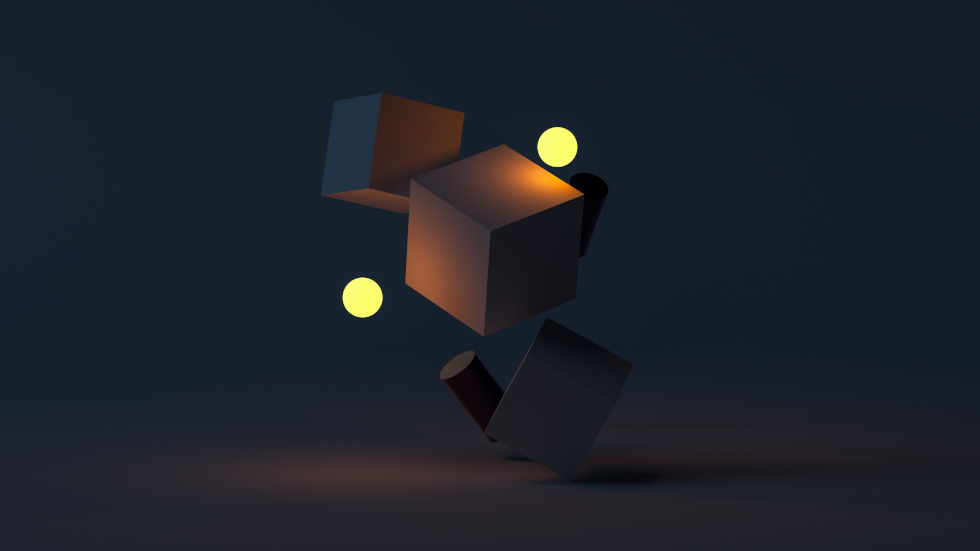

This post is **Part 2** in a [series] to share my journey in developing [Ruxel], a simple Ray Tracer and 3D Renderer written in [Rust], from scratch.

## Generics Refactor
what is happening
## Canvas

## Matrix

## Next Steps

---

**_Links, references and disclaimers:_**

- Header Photo by [Sebastian Svenson](https://unsplash.com/@sebastiansvenson) on [Unsplash](https://unsplash.com/).
- The [Rust] Programming Language.

[Rust]:https://www.rust-lang.org
[Ruxel]:https://github.com/rsdlt/ruxel
[series]:/categories/ray-tracer/
